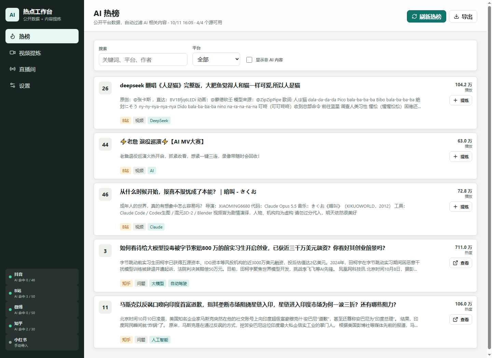

# AI Trend Studio

**Local-first AI trend radar and live-session distillation.**

   




AI Trend Studio collects public hot-topic signals, distills video and note content, and turns live sessions into structured notes. It runs on your machine, stores data in one local JSON file, works without third-party accounts, and can optionally use any OpenAI-compatible model for higher-quality summaries.

[简体中文介绍](docs/README.zh-CN.md) · [Architecture](docs/architecture.md) · [Contributing](CONTRIBUTING.md) · [Security](SECURITY.md)

## Why it exists

AI news is scattered across Douyin, Xiaohongshu, Bilibili, Weibo, Zhihu, and live streams. Most dashboards only show traffic numbers; most note-taking tools do not understand an AI discussion. AI Trend Studio combines both jobs:

1. Discover public AI-related topics, videos, and livestream rooms.
2. Turn descriptions, transcripts, comments, or notes into key points.
3. Record live sessions by speaker while the stream is happening.
4. Generate a reusable brief with conclusions, actions, and risks.

Everything remains local by default. The only network calls are the public trend APIs you enable and the optional LLM endpoint you configure.

## Highlights

- **Public trend collectors:** Douyin hot search and livestream discovery, Bilibili popular videos, Weibo hot search, and Zhihu hot list.
- **AI keyword filtering:** Customize the keyword list from the settings page; the dashboard keeps only relevant items by default.
- **Content distillation:** Import text, descriptions, comments, SRT, or VTT for any platform. Public Bilibili metadata and available public subtitles are fetched automatically.
- **Live session log:** Single-speaker or multi-guest sessions, speaker attribution, speech/caption/comment/insight event types, and transcript import.
- **Douyin live discovery:** Search a keyword, inspect public room metadata, and create a live session in one click.
- **Structured summaries:** Core conclusion, key points, action items, risks, keywords, and stats.
- **Offline-first:** A built-in Chinese extractive summarizer runs without an API key.
- **Offline dashboard assets:** The UI and icon library are bundled locally after checkout.
- **Model-agnostic:** Configure any OpenAI-compatible `/chat/completions` endpoint.
- **No Python dependencies:** Standard library backend and static frontend; easy to audit and run.
- **Local data:** State is stored in `data/db.json`; API keys are masked in UI and exports.
- **Compliance guardrails:** No CAPTCHA solving, authentication bypass, signature cracking, or protected media downloading.

## Quick start

Python 3.10 or newer is the only requirement.

```bash
git clone https://github.com/developeryj1992/ai-trend-studio.git
cd ai-trend-studio
python app.py
```

Open <http://127.0.0.1:8765>.

On Windows, double-click `start.bat`. On macOS or Linux:

```bash
./run.sh
```

## Use cases

- Track which AI products, models, and use cases are gaining attention.
- Distill a video into talking points before sharing it with a team.
- Record a course, webinar, or multi-guest live stream as structured notes.
- Keep a private research log without sending every source to a cloud service.
- Adapt the keyword list for another domain, such as robotics, fintech, or healthcare.

## Workflow

1. Open **Trends** and refresh public sources.
2. Search Douyin livestreams from **Live** when you need AI rooms.
3. Send a video to **Video Distillation** or paste a Xiaohongshu/Douyin description, transcript, or comment thread.
4. Create a **Live Session** before an AI livestream starts.
5. Add speaker events during the stream, or upload a transcript/subtitle file.
6. Click **Finish & Summarize** to generate a brief with conclusions, actions, and risks.
7. Export the complete workspace as JSON for backup or another pipeline.

## Platform support

| Platform | Automatic collection | Manual distillation | Live session log |
| --- | --- | --- | --- |
| Douyin | Public hot-search API + public live-room search | Yes | Yes |
| Bilibili | Popular videos + public metadata | Yes | Yes |
| Weibo | Public hot-search API | Yes | Yes |
| Zhihu | Public hot-question API | Yes | Yes |
| Xiaohongshu | Bring-your-own export/API | Yes | Yes |

Platform interfaces change often and may require cookies, signatures, or official authorization. AI Trend Studio intentionally avoids bypassing those controls. Douyin live discovery uses public metadata and returns a manual search-page link when the platform requires login. Xiaohongshu and protected Douyin content can still be analyzed through user-authorized text, subtitles, comments, or official exports.

## Optional model configuration

The local summarizer is always available. For model-generated summaries, open **Settings** and configure:

```text
Base URL: https://api.openai.com/v1
Model: gpt-4o-mini
API Key: your key
Timeout: 30
```

Any endpoint compatible with the OpenAI Chat Completions API works. The key is written only to `data/db.json` on your machine and is not included in UI state or exported JSON.

## Project structure

```text
app.py              Standard-library HTTP API, collectors, and summarizer
static/             Static dashboard UI
tests/              Unit tests
data/db.json        Local workspace data, created at runtime
docs/               Architecture and language-specific documentation
```

## Roadmap

- Source plugin API for official/authorized platform connectors
- Background scheduler with per-source intervals
- Markdown and HTML report export
- Speaker timeline and topic clustering
- Local semantic search
- Multi-workspace support
- PWA packaging for tablets

Contributions are welcome, especially new public or official API connectors, UI polish, and tests. See [CONTRIBUTING.md](CONTRIBUTING.md).

## Compliance

Use only data you are authorized to access. Do not use this project to violate platform terms, bypass technical protections, scrape private content, or redistribute copyrighted media. The intended inputs are public metadata, user-provided text, licensed transcripts, and content you own or have permission to process.

## License

Released under the [MIT License](LICENSE).
